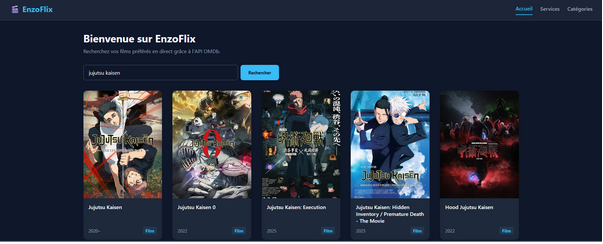

# EnzoFlix
Charte graphique du site
-------------------------------------------------------------------------------------------
La palette de couleurs

- Bleu nuit
    #071B35
        Couleur principale utilisée pour le fond du site. Elle apporte une ambiance sombre et cinématographique.
- Bleu foncé
    #123D67
        Utilisé pour les blocs, les cartes et les différentes sections. Il permet de faire ressortir les affiches des films.
- Turquoise
    #28CFC7
        Utilisé pour les boutons, les liens et les éléments interactifs afin de faciliter la navigation.

-------------------------------------------------------------------------------------------
La typographie

- Police utilisée :
    une police simple, moderne et sans empattement (sans-serif).
- Objectif :
    garantir une lecture facile et agréable.
- Utilisation :
    titres, descriptions de films, menus et boutons.
- Choix :
    privilégier une police comme Arial ou Roboto pour éviter de surcharger visuellement le site

-------------------------------------------------------------------------------------------
Pourquoi ces choix graphiques ?

- Une police lisible :
    permet aux visiteurs de consulter facilement les informations sans être gênés par une typographie trop complexe.

- Une ambiance cinématographique :
    les couleurs sombres rappellent l'atmosphère des salles de cinéma.

- Une meilleure mise en valeur : 
    les affiches des films ressortent davantage grâce au fond bleu foncé.

- Une navigation agréable :
    le turquoise permet de repérer rapidement les boutons et les différentes actions.

- Une identité visuelle reconnaissable :
    l'association du bleu nuit, du bleu foncé et du turquoise donne au site une apparence moderne et élégante, dans l'esprit de Netflix, mais avec une identité bleue qui lui est propre.
-------------------------------------------------------------------------------------------
Exemple du rendu visuel

- Voici une idée de l'association des couleurs sur une interface de site de streaming :

-------------------------------------------------------------------------------------------
Conclusion :

    Cette charte graphique a pour objectif de donner au site une identité visuelle cohérente et reconnaissable. Les couleurs sombres créent une atmosphère immersive, tandis que le turquoise apporte du contraste et facilite l'utilisation du site. La typographie simple garantit une lecture confortable. L'ensemble donne un rendu moderne, élégant et inspiré des plateformes de streaming comme Netflix.
